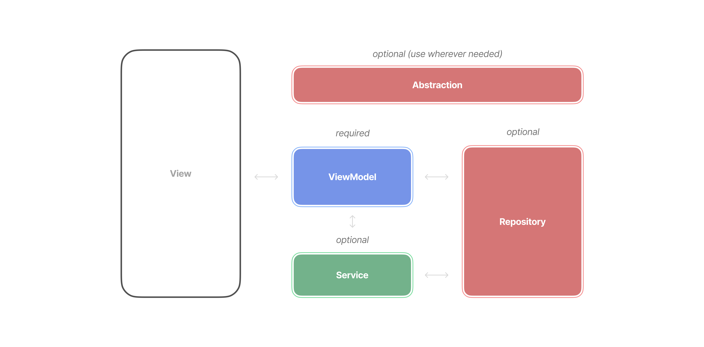

# Guided Tour

This guided tour is a walkthrough of the key features of Flutter Kit. It doesn't cover everything, but after walking through it, you should have a sense of how to work with it.

Let's start building!

## Getting Started

Let's start by creating a project and exploring what you get out of the box.

> [!WARNING]
> **Before you begin**
>
> Make sure you have Flutter installed. If not, [follow the Flutter installation guide](https://docs.flutter.dev/get-started/install).

### Install the Hungrimind CLI

Install the CLI globally from GitHub (no account needed):

```bash
npm install -g github:hungrimind/hungrimind-cli
```

### Create a New Flutter Project

Generate your Flutter app that uses the boilerplate with the CLI:

```bash
hungrimind flutter create my_app --org com.mycompany
```

Replace `my_app` with your project name and `com.mycompany` with your organization identifier.

### Project Structure

Open your project and take a look at the folder structure, it should look something like this. Notice how it follows the **folder by feature** approach including the `core` folder for shared code.

```text
└── lib/
    ├── core/
    │   ├── ui/
    │   │   └── ...
    │   └── utils/
    │       └── ...
    ├── home/
    │   ├── home_view.dart
    │   └── home_view_model.dart
    ├── not_found/
    │   ├── not_found_view.dart
    │   └── not_found_view_model.dart
    └── main.dart
```

Each feature (like `home`) contains everything related to that feature in one place. This keeps your codebase organized as it grows. The `core` folder contains shared code that is used across multiple features.

### Run the App

Start the app and see what's included:

```bash
flutter run
```

You'll see the startup flow in action - the app shows a loading screen while initializing, then transitions to the main interface. This is handled by the **Startup Feature** we'll explore later.

## Understand MVVM Architecture

MVVM stands for Model-View-ViewModel. It is a design pattern that separates the UI from the business logic of the application and is the recommended architecture by the Flutter team.

This boilerplate is built using the MVVM architecture, with slight variations to make it more robust and easier to maintain.



### View

The View is the UI layer of the application. It is responsible for displaying the data to the user and for handling the user's input.

### ViewModel

Each view has a 1-1 connection with a ViewModel. The ViewModel is responsible for handling the data and the logic for the view.

### Service

Each ViewModel is tied to a specific View, but what if there is logic that needs to be shared between multiple views? Services look exactly like ViewModels, but they are not tied to a specific view.

### Abstractions

The abstraction layer is responsible for handling any external dependencies and making them available via abstraction to our application. This is the only layer that can directly interact with the outside world.

### Repository

Most applications need data from external sources like a database or an API. The Repository uses relevant Abstractions to fetch/store/manipulate data externally and make it available to the application.

> [!WARNING]
> **Difference from Flutter's MVVM**
>
> This is one of the few places where the boilerplate diverges from Flutter's MVVM. **Flutter's MVVM documentation has no mention of any app-wide state management**.
>
> Because of this, what Flutter calls a `Service` is what this boilerplate calls an `Abstraction`. And the app-wide state in this boilerplate is handled with a `Service`.

## Build Your First Feature

Now let's add a completely new feature to understand the typical development workflow. You don't have to follow this exact pattern, but it's a good starting point.

### Create a Todo Feature

We'll build a simple todo list feature that demonstrates all the core concepts.

Add the following feature folder to your project:

```text
└── lib/
    └── todo/
        ├── todo_view.dart
        ├── todo_view_model.dart
        ├── todo_service.dart
        ├── todo_model.dart
        └── todo_repository.dart
```

### Create the Service

When I am building applications, I always like to start from the data first. For this feature, our data will be used across the application, so it should be stored in a service that is accessible app-wide. Step one is creating the todo data class.

```dart
// lib/todo/todo_model.dart
class Todo {
  const Todo({required this.id, required this.title, this.isCompleted = false});

  final String id;
  final String title;
  final bool isCompleted;

  Todo copyWith({String? id, String? title, bool? isCompleted}) {
    return Todo(
      id: id ?? this.id,
      title: title ?? this.title,
      isCompleted: isCompleted ?? this.isCompleted,
    );
  }

  factory Todo.fromJson(Map<String, dynamic> json) {
    return Todo(
      id: json['id']?.toString() ?? '',
      title: json['title'] as String? ?? '',
      isCompleted: json['completed'] as bool? ?? false,
    );
  }
}

```

Next, let's create the service class. This service will have two functions:

- `addTodo` - adds a new todo
- `toggleTodo` - toggles the state between completed and uncompleted

> [!WARNING]
> **Dispose**
>
> We always add a dispose; however, this `TodoService` will run from when the app is open until it's closed, so the `ValueNotifier` would be garbage collected anyway. Not disposing shouldn't affect your app's function, but it is a good practice to always do it. In a different example, you might not need the `ValueNotifier` for the entire app, so you would need to dispose of it.

> [!WARNING]
> **Imports**
>
> In all our example code, we don't show the imports to keep the code clean. If you are copy-pasting, make sure you import the correct files.

```dart
// lib/todo/todo_service.dart
class TodoService {
  final ValueNotifier<List<Todo>> todoNotifier = ValueNotifier([]);

  void addTodo(String title) {
    final newTodo = Todo(
      id: DateTime.now().millisecondsSinceEpoch.toString(),
      title: title,
    );

    todoNotifier.value = [...todoNotifier.value, newTodo];
  }

  void toggleTodo(String id) {
    final updatedTodos = todoNotifier.value.map((todo) {
      if (todo.id == id) {
        return todo.copyWith(isCompleted: !todo.isCompleted);
      }
      return todo;
    }).toList();

    todoNotifier.value = updatedTodos;
  }

  void dispose() {
    todoNotifier.dispose();
  }
}
```

### Register the Service

Add your service to the locator so it's available app-wide:

```dart
// lib/config/locator_config.dart
Module<TodoService>(
  builder: () => TodoService(),
  lazy: false,
),
```

### Create the ViewModel

```dart
// lib/todo/todo_view_model.dart
class TodoViewModel {
  TodoViewModel({required TodoService todoService})
    : _todoService = todoService;

  final TodoService _todoService;

  ValueNotifier<List<Todo>> get todos => _todoService.todoNotifier;

  void addTodo(String title) {
    final trimmed = title.trim();
    if (trimmed.isNotEmpty) {
      _todoService.addTodo(trimmed);
    }
  }

  void toggleTodo(String id) {
    _todoService.toggleTodo(id);
  }

  void dispose() {
    // No-op for now
  }
}
```

### Create the View

This is a simple view that shows a form to add a new todo and a list of todos.

> [!NOTE]
> **UI Constants**
>
> This Flutter Kit comes with a set of UI constants that you can customize. In this example, we are using the `context.spacing` to add padding and `context.kitColors` to add colors.

```dart
// lib/todo/todo_view.dart
class TodoView extends StatefulWidget {
  const TodoView({super.key});

  @override
  State<TodoView> createState() => _TodoViewState();
}

class _TodoViewState extends State<TodoView> {
  late final TodoViewModel _viewModel;
  final TextEditingController _textController = TextEditingController();

  @override
  void initState() {
    super.initState();
    _viewModel = TodoViewModel(
      todoService: locator<TodoService>(),
    );
  }

  @override
  void dispose() {
    _textController.dispose();
    _viewModel.dispose();
    super.dispose();
  }

  @override
  Widget build(BuildContext context) {
    return Scaffold(
      appBar: AppBar(title: const Text('Todo List')),
      body: ValueListenableBuilder<List<Todo>>(
        valueListenable: _viewModel.todos,
        builder: (context, todos, _) {
          return Column(
            children: [
               Padding(
                padding: EdgeInsets.all(context.spacing.md),
                child: Row(
                  children: [
                    Expanded(
                      child: TextField(
                        controller: _textController,
                        decoration: const InputDecoration(
                          hintText: 'Add a new todo...',
                        ),
                      ),
                    ),
                    SizedBox(width: context.spacing.sm),
                    ElevatedButton(
                      onPressed: () {
                        _viewModel.addTodo(_textController.text);
                        _textController.clear();
                      },
                      child: const Text('Add'),
                    ),
                  ],
                ),
              ),
              Expanded(
                child: ListView.builder(
                  itemCount: todos.length,
                  itemBuilder: (context, index) {
                    final todo = todos[index];
                    return ListTile(
                      title: Text(
                        todo.title,
                        style: todo.isCompleted
                            ? TextStyle(
                                decoration: TextDecoration.lineThrough,
                                color: context.kitColors.neutral500,
                              )
                            : null,
                      ),
                      leading: Checkbox(
                        value: todo.isCompleted,
                        onChanged: (_) => _viewModel.toggleTodo(todo.id),
                      ),
                    );
                  },
                ),
              ),
            ],
          );
        },
      ),
    );
  }
}

```

### Add New Route

Add your new view to the router:

```dart
// lib/config/route_config.dart
GoRoute(
  path: '/todos',
  pageBuilder: (context, state) => _buildPage(const TodoView(), state),
),
```

Now you can navigate to this fully working todo page. You can do it anywhere in your app, but for this showcase, we are going to hijack the start-up logic and navigate as soon as the app is initialized.

```dart ins={7}
// lib/startup/startup_view_model.dart
Future<void> initializeApp() async {
  appStateNotifier.value = const InitializingApp();
  try {
    locator.registerMany(modules);
    loggingSubscription = _loggingAbstraction.initializeLogging();
    locator<RouterService>().go('/todos');
    appStateNotifier.value = const AppInitialized();
  } catch (e, st) {
    appStateNotifier.value = AppInitializationError(e, st);
  }
}
```

## Use APIs

Let's enhance our todo feature to work with a real API.

### Create a Repository

```dart
// lib/todo/todo_repository.dart
class TodoRepository {
  TodoRepository({required HttpAbstraction httpAbstraction})
    : _httpAbstraction = httpAbstraction;

  final HttpAbstraction _httpAbstraction;

  Future<List<Todo>> fetchTodos() async {
    try {
      final response = await _httpAbstraction.get(
        Uri.parse("https://jsonplaceholder.typicode.com/todos"),
      );

      if (response.statusCode == 200) {
        final List<dynamic> jsonData = jsonDecode(response.body);
        return jsonData.map((json) => Todo.fromJson(json)).toList();
      } else {
        throw Exception('Failed to load todos: ${response.statusCode}');
      }
    } catch (e) {
      rethrow;
    }
  }
}
```

### Update the Service

Switch the existing service to use the repository to load todos, without adding extra state:

```dart ins={3-6,9-12} {10-11} collapse={15-20, 24-31}
// lib/todo/todo_service.dart
class TodoService {
  TodoService({required TodoRepository todoRepository})
      : _todoRepository = todoRepository;

  final TodoRepository _todoRepository;
  final ValueNotifier<List<Todo>> todoNotifier = ValueNotifier<List<Todo>>([]);

  Future<void> loadTodos() async {
    final todos = await _todoRepository.fetchTodos();
    todoNotifier.value = todos;
  }

  void addTodo(String title) {
    final newTodo = Todo(
      id: DateTime.now().millisecondsSinceEpoch.toString(),
      title: title,
    );

    todoNotifier.value = [...todoNotifier.value, newTodo];
  }

  void toggleTodo(String id) {
    final updatedTodos = todoNotifier.value.map((todo) {
      if (todo.id == id) {
        return todo.copyWith(isCompleted: !todo.isCompleted);
      }
      return todo;
    }).toList();

    todoNotifier.value = updatedTodos;
  }

  void dispose() {
    todoNotifier.dispose();
  }
}
```

When using `ValueNotifier<List<Todo>>`, always assign a new list (e.g., spread into a new list) instead of mutating the existing list in place. `ValueNotifier` notifies listeners only when its `value` reference changes.

### Access the Repository

In order for your app to access the repository, you need to register it with the locator. And the todo service now requires the repository to be injected. Notice here that the service must come after the repository in the registration.

```dart del={9} ins={2-7, 10-12}
// lib/config/locator_config.dart
Module<TodoRepository>(
  builder: () => TodoRepository(
    httpAbstraction: locator<HttpAbstraction>(),
  ),
  lazy: false,
),
Module<TodoService>(
  builder: () => TodoService(),
  builder: () => TodoService(
    todoRepository: locator<TodoRepository>(),
  ),
  lazy: false,
),
```

### Update the ViewModel

Trigger the initial load from the repository; everything else stays the same as the non-API-backed version:

```dart ins={11-13} {12} collapse={15-29}
// lib/todo/todo_view_model.dart
class TodoViewModel {
  TodoViewModel({required TodoService todoService})
      : _todoService = todoService;

  final TodoService _todoService;

  ValueNotifier<List<Todo>> get todos => _todoService.todoNotifier;

  Future<void> init() async {
    await _todoService.loadTodos();
  }

  void addTodo(String title) {
    final trimmed = title.trim();
    if (trimmed.isNotEmpty) {
      _todoService.addTodo(trimmed);
    }
  }

  void toggleTodo(String id) {
    _todoService.toggleTodo(id);
  }

  void dispose() {
    // No-op for now
  }
}
```

### Update the View

Only trigger the initial load; the UI stays the same:

```dart ins={11} {11} collapse={14-77}
// lib/todo/todo_view.dart
class _TodoViewState extends State<TodoView> {
  late final TodoViewModel _viewModel;
  final TextEditingController _textController = TextEditingController();

  @override
  void initState() {
    super.initState();
    _viewModel = TodoViewModel(
      todoService: locator<TodoService>(),
    );
    _viewModel.init();
  }

  @override
  void dispose() {
    _textController.dispose();
    _viewModel.dispose();
    super.dispose();
  }

  @override
  Widget build(BuildContext context) {
    return Scaffold(
      appBar: AppBar(title: const Text('Todo List')),
      body: ValueListenableBuilder<List<Todo>>(
        valueListenable: _viewModel.todos,
        builder: (context, todos, _) {
          return Column(
            children: [
              Padding(
                padding: EdgeInsets.all(context.spacing.md),
                child: Row(
                  children: [
                    Expanded(
                      child: TextField(
                        controller: _textController,
                        decoration: const InputDecoration(
                          hintText: 'Add a new todo...',
                        ),
                      ),
                    ),
                    SizedBox(width: context.spacing.sm),
                    ElevatedButton(
                      onPressed: () {
                        _viewModel.addTodo(_textController.text);
                        _textController.clear();
                      },
                      child: const Text('Add'),
                    ),
                  ],
                ),
              ),
              Expanded(
                child: ListView.builder(
                  itemCount: todos.length,
                  itemBuilder: (context, index) {
                    final todo = todos[index];
                    return ListTile(
                      title: Text(
                        todo.title,
                        style: todo.isCompleted
                            ? TextStyle(
                                decoration: TextDecoration.lineThrough,
                                color: context.kitColors.neutral500,
                              )
                            : null,
                      ),
                      leading: Checkbox(
                        value: todo.isCompleted,
                        onChanged: (_) => _viewModel.toggleTodo(todo.id),
                      ),
                    );
                  },
                ),
              ),
            ],
          );
        },
      ),
    );
  }
}
```

## What's Next?

You now have a solid understanding of the Flutter Kit! Here's what you can explore next:

1. **[API Requests](../guides/http.md)** - Advanced API integration patterns
2. **[Navigation](../guides/routing.md)** - Advanced navigation patterns and examples
3. **[Theming](../guides/theme.md)** - Styling, spacing, colors, and typography
4. **[Logging](../guides/logging.md)** - Structured logging across environments
5. **[Startup](../guides/startup.md)** - Configure app startup flows
6. **[Internal Notification](../guides/internal-notification.md)** - Toasts and haptic feedback
7. **[Translations](../guides/localization.md)** - Internationalization and localization
8. **[Testing](../concepts/testing.md)** - Unit vs widget testing with examples
9. **[Deployment](../guides/deployment.md)** - Deploy your app to production
