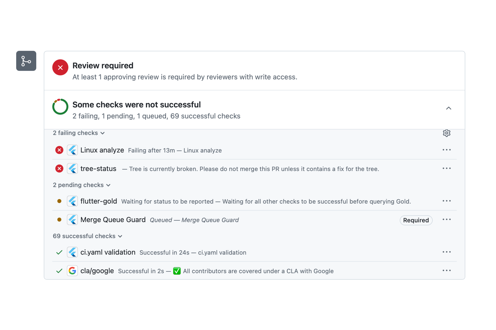

# Deploy your App

A Flutter app only becomes a product once it's released into the world and other people can use it. You can do this [deployment process manually](https://docs.flutter.dev/deployment), but setting up CI/CD will make life a lot easier.

## CI/CD

This acronym stands for Continuous Integration and Continuous Deployment (or Delivery). These are automatic systems that check your code and are triggered based on conditions that you define. Here is the most common workflow and what we use.

### CI

When working on code, you create a branch off of the main branch. Every time you make a commit, this branch will run the CI checks. And you are not allowed to merge the branch in until all those checks are successful.

You can see a ton of CI workflows within the official Flutter pull requests.



### CD

The deployment automation gets triggered when your code is merged into main. Once all the CI checks are passing, once the code has been reviewed and approved, it should be ready to ship to production.

This is where you can go the manual path and spend lots of time creating a bundle and uploading it to all the different app stores you support. Or you can have a good CD system so you can go work on the next feature to make your product better.

## Deploying on Web

There are two approaches you can take to deploy your Flutter app.

1. Manually from the CLI
2. Automatically from a GitHub action

There a few solutions you can use for both of these. Our preferred solution is Globe due to it's simplicity, but you can use Firebase Hosting as well.

## Via CLI

### Globe

1. Create an account with [Globe](https://globe.dev/).
2. Install the Globe CLI

```bash
dart pub global activate globe_cli
```

3. Login to Globe

```bash
globe login
```

4. Deploy your app

```bash
globe deploy
```

### Firebase

1. Create an account with [Firebase](https://firebase.google.com/).
2. Install the Firebase CLI

```bash
npm install -g firebase-tools
```

3. Login to Firebase

```bash
firebase login
```

4. Initialize Firebase

```bash
firebase init
```

Select Hosting and follow the prompts

```markdown
What do you want to use as your public directory? build/web
Configure as a single-page app (rewrite all urls to /index.html)? Yes
Set up automatic builds and deploys with GitHub? No
File build/web/index.html already exists. Overwrite? No
```

5. Deploy your app

```bash
firebase deploy
```

## Via GitHub Action

### Globe

1. Push your code to a private GitHub repo
2. Go to the [Globe dashboard](https://globe.dev/dashboard) and import your GitHub repo
3. The default settings are good, but make sure to select the latest Flutter version, or your build will fail
4. Click `Deploy` and you're done

Every time you push to your repo, Globe will automatically deploy your app.

### Firebase Hosting

You need to create a service account to deploy to Firebase. Follow the [GitHub Action Firebase Documentation.](https://github.com/FirebaseExtended/action-hosting-deploy/blob/main/docs/service-account.md)

Add the following GitHub workflow into your repository:

```yaml title=".github/workflows/deploy-web.yaml"
name: Deploy

on:
  push:
    branches:
      - main

env:
  FLUTTER_VERSION: "3.41.2"
  CHANNEL: "stable"

jobs:
  deploy-web:
    name: Deploy Web
    runs-on: ubuntu-latest
    steps:
      - uses: actions/checkout@v4

      - uses: subosito/flutter-action@v2
        with:
          channel: ${{ env.CHANNEL }}
          flutter-version: ${{ env.FLUTTER_VERSION }}

      - name: Install dependencies
        run: flutter pub get

      - name: Build web
        run: flutter build web

      - uses: FirebaseExtended/action-hosting-deploy@v0
        with:
          firebaseServiceAccount: "${{ secrets.FIREBASE_SERVICE_ACCOUNT }}"
          channelId: live
```

Once this is set up, every time you commit changes to your repo, it will get deployed automatically.

## Deploying on Other Platforms

Currently, we use [Codemagic](https://codemagic.io/start/) for CI/CD, click the link to see the most up to date guides.

## Learn more

- [Flutter Deployment Docs](https://docs.flutter.dev/deployment)
- [CodeMagic Deployment](https://codemagic.io/start/)
- [Globe Deployment](https://globe.dev/)
- [Firebase Hosting](https://firebase.google.com/)
